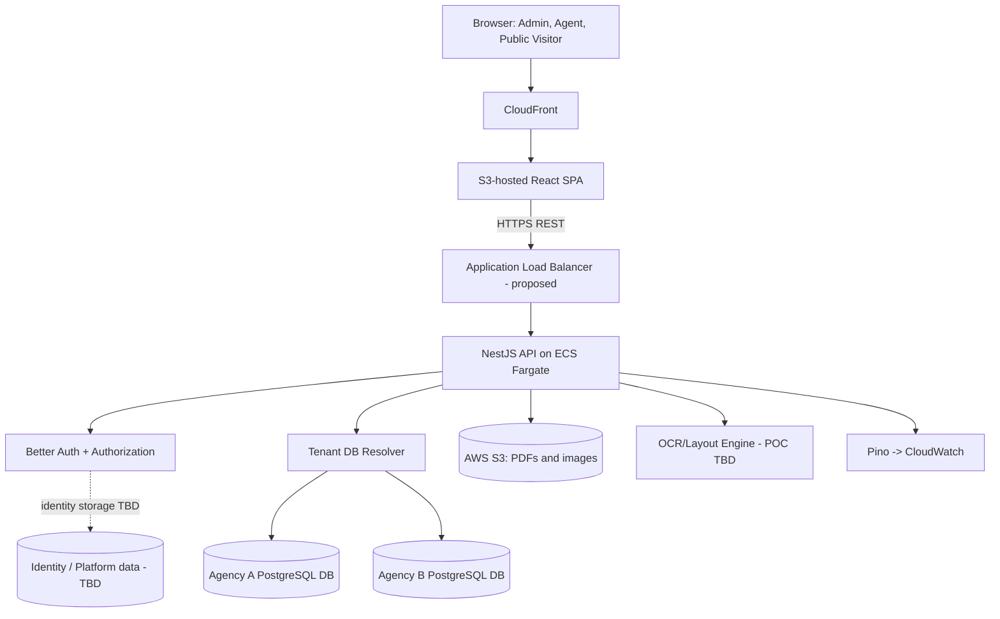
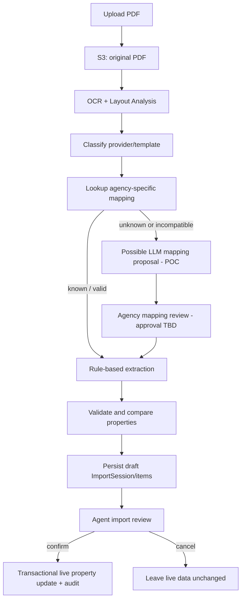

# property-agent — Technical Design Document

**Version:** 1.0 (Draft)  
**Status:** Technical design baseline — subject to POC and outstanding decisions  
**Repository:** https://github.com/Olivia-cyx98/property-agent  
**Last updated:** 2026-10-23

## 1. Purpose and Scope

This document captures the agreed technical direction for **property-agent**, a multi-agency property listing management platform. Agents within an agency manage a shared property catalogue, import provider PDFs, review proposed listing changes, and control which properties appear on an agency's public-facing pages. Platform administrators manage agency and agent accounts. Buyers and investors can initially browse published listings without signing in.

The document distinguishes:

- **Confirmed:** explicitly selected during technical discovery.
- **Proposed:** recommended implementation, not yet approved.
- **TBD / POC:** unresolved or requiring validation.
- **Future:** intentionally deferred beyond the initial MVP.

This is a technical design, not a claim that any system has been implemented. The initial development approach is **local-first**; AWS deployment is the selected production direction.

## 2. Architectural Principles

1. **Tenant separation:** each agency has its own PostgreSQL database (**Confirmed**). Do not allow a client-supplied agency or database identifier to determine database access without server-side authorization.
2. **Review before mutation:** PDF parsing generates draft import data; live property records change only after an agent confirms the import (**Confirmed product requirement**).
3. **Agency-specific mappings:** extraction mappings belong to their agency and are not automatically shared across agencies (**Confirmed**).
4. **Start simple:** use synchronous PDF processing for the MVP and defer job queues/workers until measured need (**Confirmed**).
5. **Technology-agnostic OCR:** evaluate OCR and layout-analysis engines with representative PDFs before selecting a provider (**Confirmed**).
6. **Incremental infrastructure:** develop locally first, then establish staging and production on AWS (**Confirmed**).
7. **Defence in depth:** backend authorization, private file access, input validation, safe error handling, secrets management, and tenant-isolation tests are baseline requirements.

## 3. Technology Decision Register

| Area | Decision | Status |
|---|---|---|
| Frontend | React + TypeScript | Confirmed |
| UI component library | Material UI (MUI) | Confirmed |
| Client routing | React Router | Confirmed |
| Client/server state | Select Redux Toolkit, RTK Query, Context, and hooks according to need | TBD |
| Backend | Node.js + NestJS + TypeScript | Confirmed |
| API | REST + OpenAPI / Swagger | Confirmed |
| Database | PostgreSQL | Confirmed |
| ORM | Prisma | Confirmed |
| Authentication | Better Auth | Confirmed |
| Roles | Platform Admin and Agent; anonymous public visitors | Confirmed |
| Tenancy | Separate PostgreSQL database per agency | Confirmed |
| Identity/database ownership | Central identity database vs tenant-specific identity storage | TBD |
| Property data model | Fixed columns vs JSONB vs hybrid | TBD, informed by PDF POC |
| Object/file storage | AWS S3 | Confirmed |
| PDF extraction | OCR + layout analysis; engine chosen via POC | Confirmed approach / engine TBD |
| Property extraction | Prefer reusable rules/mappings; LLM assistance only when useful | Proposed; POC required |
| Mapping ownership | Agency-specific | Confirmed |
| Mapping approval process | Agency review considered; exact rules pending POC | TBD |
| PDF execution | Synchronous for MVP | Confirmed |
| Background queue | Deferred; BullMQ/Redis or SQS not selected | Future |
| Repository | Monorepo + pnpm Workspaces | Confirmed |
| Cloud provider | AWS | Confirmed |
| Frontend production hosting | S3 + CloudFront | Confirmed |
| Backend production hosting | ECS + Fargate | Confirmed |
| Container registry | Amazon ECR | Proposed |
| Database hosting | RDS PostgreSQL, single instance with multiple databases favoured | TBD / POC |
| Tenant database provisioning | Semi-automatic internal CLI favoured | TBD |
| CI/CD | GitHub Actions; CI now, AWS CD later | Confirmed |
| Testing | Balanced: unit + integration, critical E2E | Confirmed |
| Logging | Pino | Confirmed |
| Cloud logs/monitoring | AWS CloudWatch | Confirmed |
| Secrets | Environment variables + AWS Secrets Manager | Confirmed |
| Environments | Local first; staging and production later | Confirmed |
| Security | Production-oriented MVP controls without premature complexity | Confirmed |
| Error handling | Centralised NestJS exception handling | Confirmed |
| Backup/recovery | Phased: local validation, initial production backup, later tenant-level recovery | Confirmed |
| Backend modular monolith | Preferred initial architecture | Proposed |

## 4. High-Level System Architecture



**Important:** diagram components such as an ALB, identity storage topology, and OCR service are proposals or placeholders until specified. The database-per-agency decision does **not** imply a dedicated RDS instance per agency.

### 4.1 Runtime boundaries

- **Web app:** React SPA encompassing platform admin, agent dashboard, and agency public property pages. Public-page URL layout is TBD.
- **Backend API:** NestJS modules exposing documented REST endpoints and applying authentication, authorization and input validation.
- **Tenant databases:** tenant-specific properties, import drafts, mappings and change history; final table details remain TBD.
- **S3:** raw provider PDFs and property images. PostgreSQL stores references/metadata, not file binaries.
- **OCR/layout service:** interchangeable adapter selected after empirical POC.

## 5. Repository and Local Development

**Confirmed:** one GitHub monorepo using pnpm Workspaces.

Proposed layout:

```text
property-agent/
├── apps/
│   ├── web/                     # React + TypeScript + MUI
│   └── api/                     # NestJS + TypeScript
├── packages/
│   ├── api-client/              # Generated OpenAPI client (proposed)
│   ├── shared-types/            # Truly shared contracts (optional)
│   └── eslint-config/           # Shared tooling (optional)
├── infra/                       # Docker and future IaC (proposed)
├── docs/
│   ├── technical-design.md
│   └── poc/
├── .github/workflows/
├── pnpm-workspace.yaml
└── package.json
```

Local-first development may use Docker Compose with PostgreSQL and multiple databases (e.g. development agency A and B). Whether there is a local platform identity database remains dependent on the **Database Ownership** decision. Keep secrets in ignored local environment files; commit only redacted `.env.example` templates.

## 6. Frontend Design

### 6.1 Application areas

- **Platform Admin:** manage agencies and agents, including invitation/deactivation flows.
- **Agent Dashboard:** property CRUD, bulk status/visibility/delete, images, search/filtering, PDF imports, review, mappings, and change history.
- **Agency Public Pages:** card grid, detail page, image gallery and filtering; initially browsable without buyer accounts.

React Router is confirmed. Illustrative routes (not approved URL contracts):

```text
/login
/admin/agencies
/admin/agents
/dashboard/properties
/dashboard/imports
/dashboard/imports/:importId/review
/agency/:agencySlug/properties/:propertyId
```

The public page URL/domain strategy and SEO/SSR requirements remain open; S3 + CloudFront SPA hosting is the current production decision.

### 6.2 State handling

Do not select a universal global-state solution prematurely. Evaluate state by lifetime, scope and source of truth:

- Better Auth client/session handling for authentication state.
- React hooks for component-local interactions.
- URL query parameters for bookmarkable property filtering and sorting.
- React Context for small cross-cutting UI concerns.
- Redux Toolkit for complex shared client draft state if necessary.
- RTK Query if selected for REST fetching, caching, invalidation and mutations.

Keep **Import Review drafts** separate from live property server state; no unconfirmed review edit should mutate a live property.

## 7. Backend Design

**Confirmed:** NestJS, TypeScript, REST, Swagger/OpenAPI, centralised exception handling. **Proposed:** modular monolith.

Potential NestJS modules:

```text
AuthModule
AgencyModule
AgentModule
TenantModule
PropertyModule
ImportModule
DocumentProcessingModule
MappingModule
AuditModule
PublicListingsModule
StorageModule
```

Use DTO validation, role guards and a server-side tenant resolver. Prefer service-layer authorization so it cannot be bypassed by direct module calls.

### 7.1 API outline (proposed, not final contracts)

```http
GET    /api/v1/properties
GET    /api/v1/properties/:id
POST   /api/v1/properties
PATCH  /api/v1/properties/:id
DELETE /api/v1/properties/:id
PATCH  /api/v1/properties/bulk
POST   /api/v1/imports
GET    /api/v1/imports/:id
PATCH  /api/v1/imports/:id/review
POST   /api/v1/imports/:id/confirm
GET    /api/v1/properties/:id/history
```

Document request/response schemas, pagination, sorting, validation errors, authentication and permissions in OpenAPI. The Better Auth routes follow the selected framework integration and should not be invented as ordinary CRUD endpoints.

### 7.2 Centralised exceptions

Use a NestJS global exception filter (or equivalent central mechanism) that returns a consistent safe error envelope:

```json
{
  "error": {
    "code": "PROPERTY_VALIDATION_FAILED",
    "message": "Property data validation failed.",
    "requestId": "req-example-123",
    "details": [{ "field": "price", "message": "Price must be valid." }]
  }
}
```

Map known validation/auth/authorization/conflict errors to appropriate HTTP codes. Avoid exposing internal stack traces, connection details, raw PDF contents or secrets. **Recoverable per-item PDF extraction issues** belong in Import Review warnings, not necessarily in a failed entire HTTP request.

## 8. Authentication and Authorisation

- **Authentication:** Better Auth (**Confirmed**).
- **MVP roles:** `PLATFORM_ADMIN`, `AGENT` (**Confirmed**).
- **Public visitors:** view only appropriately published listings without login (**provisional product direction**).
- **Agency membership:** one agent belongs to exactly one agency for MVP (**Confirmed product requirement**).
- **Agency collaboration:** agents of the same agency can view/edit its properties (**Confirmed product requirement**).

A Platform Admin manages agencies and agents; this role must **not** automatically receive unrestricted access to all agencies' private properties without a separately authorized support-access design.

Backend sequence: validate session → determine server-trusted role/membership → resolve permitted tenant database → authorize business action → execute. Validate tenant boundaries on file operations and imports as well as property CRUD. Prefer secure cookie/session defaults and appropriate CSRF/CORS protections for the chosen Better Auth deployment topology.

## 9. Multi-Tenant Database Design

### 9.1 Confirmed isolation model

**One PostgreSQL database per agency.** Tenant-specific data must not be co-mingled in a shared property table across agencies. A single RDS PostgreSQL instance hosting multiple databases is a **favoured but unconfirmed** production candidate.

### 9.2 Open topology decision

- **Option A:** central identity/platform database for Better Auth users, sessions, agency registry and membership; separate databases for each agency's business data.
- **Option B:** agency-specific identity and business storage plus a separate mechanism for platform-wide admin/registration.

**Status: TBD.** This decision materially affects Better Auth integration, Prisma clients, platform administrator behavior and tenant provisioning.

### 9.3 Prisma and tenant connections

Design a trusted tenant database registry and client management strategy. Never accept arbitrary connection strings from HTTP requests or job payloads. Limit pooled connections and client count. Migration execution must target intended tenant databases, use least-privileged runtime credentials, and be separately controlled from normal API request handling.

### 9.4 Tenant provisioning — proposed

A semi-automatic internal CLI is the current preferred candidate:

1. Create pending Agency record in the eventual platform registry.
2. Provision separate PostgreSQL database using administrative credentials outside the public API.
3. Apply tenant Prisma migrations.
4. Register the tenant's credential reference and verify connectivity.
5. Activate Agency only after successful verification.

**Status: TBD.** Handle partial failures, retries, secret rotation and offboarding explicitly in the final design.

### 9.5 Property model — TBD

Evaluate a fixed-column, JSONB-heavy, or hybrid data model after inspecting actual provider PDFs. Independently of the choice, indexing and query support must cover MVP keyword/location/price/type/bedroom/status/sort use cases. Candidate entities, subject to schema decisions:

```text
Property
PropertyImage
ImportSession
ImportItem
ExtractionMapping
PropertyChangeLog
```

## 10. PDF Import and Extraction

### 10.1 Product workflow (confirmed requirements)

1. An Agent uploads a provider PDF, potentially containing multiple listings.
2. The system extracts data and identifies new/existing listings and changes.
3. An Import Review shows new entries, changed fields, and extraction problems.
4. The Agent may correct, skip or remove entries from **this import**; removing an entry does not delete an existing property.
5. The Agent selects visibility for new listings; existing listings retain their current visibility by default but may be changed during review.
6. Only after explicit confirmation are selected changes committed to live properties and field-level history.
7. Partially successful parsing is allowed, with item-level errors and the ability to cancel.

Duplicate-matching criteria and handling of properties absent from a new provider document remain **TBD**.

### 10.2 Processing design

**MVP execution: synchronous** (**Confirmed**). The HTTP request performs parsing and persists an import draft before returning the review result or its reference. No BullMQ/SQS worker is included at launch.



**POC constraints:** the exact OCR engine, rule-first/LLM fallback behavior, template classification, scope of mapping review, and approval automation are not yet finalized. Agency-specific mapping ownership **is** confirmed.

### 10.3 Rule-first concept — proposed

Use existing approved agency mappings to minimize repeat LLM calls. For an unknown format, consider an LLM-generated **declarative mapping proposal** rather than executable generated code. Schema mapping (e.g. `Lot` → `unitNumber`) is distinct from extraction rules (record boundaries, table parsing, transformations and validation). Only allow pre-defined, validated transformation operations. Mapping approval by an Agency is a proposed design, **not yet confirmed**.

Store mapping versions, template fingerprints and the mapping version used by each import to support diagnostics and regression testing. Mapping remains private to its own agency.

### 10.4 OCR/Layout POC plan

Compare AWS Textract, Azure Document Intelligence and Google Document AI (and optionally an open-source baseline) with representative provider PDFs. Evaluate:

- OCR accuracy for prices, unit/lot numbers and addresses.
- Tables, layout and multi-page/multi-property segmentation.
- Accuracy of matching extracted fields to schema.
- Behavior on scanned vs text-native PDFs.
- Error reporting and source-page/region traceability.
- Runtime, pricing and implementation effort.
- Rule reuse rate and LLM calls per repeated template.
- Regression accuracy after a template change.

Prepare human-verified expected outputs (ground truth) and evaluate at listing **and** field level. Do not claim that an extracted record is correct merely because it is valid JSON.

### 10.5 Synchronous processing risks

OCR calls can exceed reverse proxy, ALB, application or third-party service timeouts. The POC must measure real document sizes and processing time. Keep processing logic callable separately from the HTTP controller so a future queue/worker can reuse it. Use request idempotency and persisted import state to prevent repeated uploads/confirmations from causing duplicate live writes.

## 11. Property Management and Audit

The MVP includes property details, editing, deletion, status changes, image management, bulk status updates, bulk visibility changes, bulk deletes, and field-level history.

Supported candidate listing statuses (**confirmed product direction**): `Available`, `Reserved / Under Offer`, `Sold`, `Off Market`. Visibility (`Public` / `Hidden`) is separate from listing status. Do not assume all sold/off-market listings are hidden. Specific deletion semantics (hard, soft or archive) remain **TBD**.

For each committed field change, capture the property, field, old/new values, timestamp and actor/source as applicable. The exact audit schema, retention, and version-restore features remain open. Prefer transactional consistency between live property mutations and their audit events, or an explicitly reliable alternative.

## 12. AWS S3 File Storage

**Confirmed:** S3 for provider PDFs and property images. **Proposed:** private source PDFs, authorized temporary access, appropriately controlled public image delivery. Suggested object-key structure:

```text
agencies/{agencyId}/imports/{importId}/source.pdf
agencies/{agencyId}/properties/{propertyId}/images/{imageId}.jpg
```

Key format and bucket topology remain TBD. Validate upload size/type/content and apply least-privilege IAM access. Do not grant file access based only on a client-supplied key. Use presigned URLs when appropriate, and never expose AWS secrets in the browser.

## 13. AWS Infrastructure and Deployment

### 13.1 Selected production direction

- **Frontend:** built React SPA on private S3, served via CloudFront with Origin Access Control (confirmed hosting; OAC proposed).
- **Backend:** containerized NestJS API on ECS + Fargate (confirmed).
- **Files:** AWS S3 (confirmed).
- **Logs:** Pino in application, delivered to CloudWatch in AWS (confirmed).
- **Database:** PostgreSQL, RDS candidate with one instance hosting multiple agency databases (TBD).
- **Secrets:** AWS Secrets Manager for sensitive values; environment variables for non-secret configuration (confirmed).

Proposed AWS components include ECR, an HTTPS ALB, ACM certificates, VPC/private database networking, and appropriate IAM execution/task roles. They require specific infrastructure design before implementation.

### 13.2 SPA caveat

Configure route fallback for React Router without blindly converting missing static assets into HTML. Public listing discoverability and SEO requirements remain TBD; the current S3 + CloudFront SPA choice may need revisiting if indexed property detail pages become a central product requirement.

## 14. CI/CD and Environments

**Confirmed:** GitHub Actions; begin with CI, add AWS CD later.

**Phase 1 — CI:** on pull requests run lint, TypeScript checks, unit/integration tests and builds. Include critical E2E coverage as it becomes stable. Use isolated test databases including at least two tenants.

**Phase 2 — CD:** deploy frontend to S3/CloudFront and backend container image to ECR/ECS. Prefer GitHub OIDC for short-lived AWS credentials. Keep tenant migrations as a controlled rollout step rather than executing all migrations on every API startup.

**Environment sequence:** Local → Staging → Production. Never share production credentials/data indiscriminately with lower environments.

## 15. Testing Strategy

**Confirmed:** Balanced testing, emphasizing unit and integration tests with targeted E2E tests.

**Proposed tools:** Vitest + React Testing Library (frontend), Jest + Supertest (NestJS/backend API), Playwright (critical E2E), custom golden-dataset evaluation for PDF parsing.

Priority test cases:

1. Cross-agency API and file access is denied, including tampered URLs and IDs.
2. Authentication and role checks protect all private endpoints.
3. Unconfirmed imports do not mutate live properties.
4. Confirm operations are idempotent and generate correct field-level history.
5. Partial extraction failures remain reviewable/correctable.
6. New vs existing listing visibility behaves as specified.
7. Bulk actions do not inadvertently affect other agencies.
8. Mapping/version changes are regression-tested with stored sample PDFs.

## 16. Security and Observability

**Confirmed:** production-oriented MVP security, implemented simply.

Baseline security measures:

- Validate Better Auth sessions server-side and use secure cookie/CSRF configuration as applicable.
- Enforce roles and tenant authorization at every protected API and file boundary.
- Use HTTPS in deployed environments and keep tenant databases private.
- Validate and limit uploads, use controlled S3 access and prevent arbitrary file/path access.
- Apply appropriate rate limits to authentication and sensitive endpoints.
- Use AWS Secrets Manager and least-privilege roles in AWS.
- Redact passwords, session cookies, tokens, raw PDF data and credentials from logs.
- Include security regression tests for tenancy and import workflows.

**Confirmed logging:** Pino structured logs, AWS CloudWatch for production log collection. Proposed fields: timestamp, level, requestId, module, event, duration and a carefully handled internal tenant reference. Store **property audit history** in business data; operational logs are not a substitute.

## 17. Backup and Recovery

**Confirmed:** phased approach.

| Phase | Scope | Status |
|---|---|---|
| 1 — Local | Verify `pg_dump` / `pg_restore` and migration restoration using non-production data | Proposed implementation |
| 2 — Initial production | Enable RDS automated backups/PITR if RDS chosen and regularly test isolated restores | Proposed implementation |
| 3 — Tenant recovery | Add per-agency logical backups, recovery tooling and documented operating procedures as needed | Future |

Retention, RPO and RTO are TBD. On a shared RDS instance with separate agency databases, instance-level PITR does not inherently provide direct in-place restore of one agency database; plan a controlled tenant-level restore procedure.

## 18. Open Technical Decisions

| ID | Decision | Current direction / dependency |
|---|---|---|
| TD-01 | Database ownership for Better Auth, user accounts and tenant registry | Central vs per-agency topology TBD |
| TD-02 | Property schema | Fixed vs JSONB vs hybrid after PDF samples/POC |
| TD-03 | OCR and layout engine | Comparative POC |
| TD-04 | Extraction implementation | Rule-first/LLM proposal hypothesis; POC |
| TD-05 | Mapping review/approval flow | Agency review suggested; workflow TBD |
| TD-06 | Mapping rule/template versioning and change policy | Design after POC |
| TD-07 | Matching existing properties across imports | Business rule TBD |
| TD-08 | Missing listing handling on newer provider files | Business rule TBD |
| TD-09 | Property deletion semantics | Soft/hard/archive TBD |
| TD-10 | Frontend state management selection | By state type and product complexity |
| TD-11 | RDS arrangement | Prefer evaluate single instance, multiple databases |
| TD-12 | Tenant database provisioning | Semi-automatic CLI preferred, not confirmed |
| TD-13 | Public agency URLs/domains and SEO | Product/architecture decision TBD |
| TD-14 | S3 bucket strategy and image delivery | Security and cost evaluation |
| TD-15 | Sync import limits / threshold for async processing | PDF latency POC |
| TD-16 | Backup retention, RPO and RTO | Production operational requirements |
| TD-17 | Final API contracts and Prisma models | Detailed design after unresolved items |

## 19. Suggested Implementation Roadmap

These are planning recommendations, **not committed milestones**.

**Phase A — Foundations:** pnpm workspace, React/MUI/Router, NestJS, local PostgreSQL multi-database harness, Prisma setup, Better Auth integration spike, GitHub Actions CI, Pino and centralized errors.

**Phase B — Secure tenancy and core listings:** validate trusted agency resolution, basic RBAC, agency/agent onboarding, property CRUD, visibility, statuses, search/filter, bulk operations, change audit, and cross-tenant tests.

**Phase C — Document extraction POC:** collect representative provider documents and ground truth; compare OCR/layout engines, mapping approaches and sync runtime; decide property schema and mapping review details.

**Phase D — PDF Import MVP:** S3 upload, synchronous extraction, draft ImportSession, item-level warnings, duplicate comparison, Mapping Review if approved, Import Review and idempotent confirmation.

**Phase E — Public pages and operational readiness:** agency page, property cards/detail/gallery, security hardening, smoke/E2E tests, deployment preparation, backups/recovery testing and staging.

**Phase F — AWS release:** provision selected database topology and infrastructure, deploy via GitHub Actions, verify access isolation, restore procedures, logs, limits and rollback.

## 20. Review Notes

Before treating this document as implementation-ready, review the **Open Technical Decisions** against the PRD. Highest-impact blockers are identity/tenant database ownership, property schema, duplicate matching, and realistic synchronous PDF parsing latency. The remaining decisions should be captured as Architecture Decision Records (ADRs) when finalized.

---

**Document classification:** Technical Design Draft. This document consolidates agreed conversation decisions and clearly labels unapproved recommendations; it does not describe existing production infrastructure.
